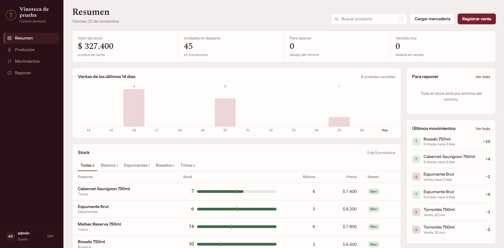
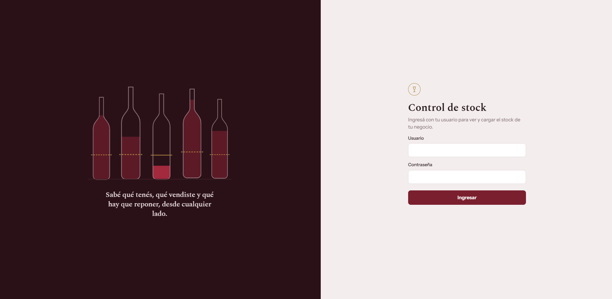
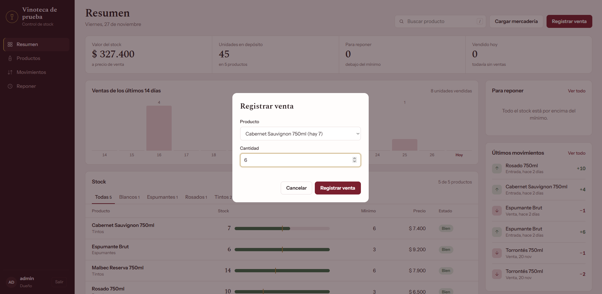
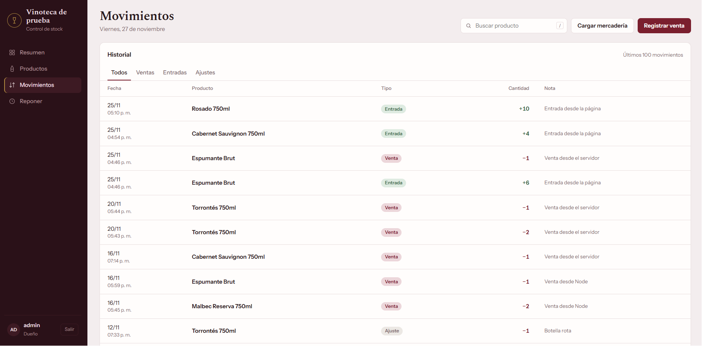

# Stock App · Control de stock para comercios

Sistema web para que un comercio chico sepa en todo momento **qué tiene, qué vendió y qué tiene que reponer**. Reemplaza la planilla de Excel o el cuaderno: se registran las ventas y la mercadería que llega, y el stock se actualiza solo.

Está armado con datos de una vinoteca de ejemplo, pero el diseño y el código están pensados para adaptarse a otros rubros.

**Demo:** [stock-app-ssrj.onrender.com](https://stock-app-ssrj.onrender.com)
La demo está protegida con usuario y contraseña. Si querés probarla, escribime y te paso un acceso.
Corre en el plan gratuito de Render, así que la primera carga puede tardar unos 30 segundos mientras el servidor se despierta.



## Qué hace

- **Resumen del negocio:** valor del stock a precio de venta, unidades en depósito, productos para reponer y lo vendido en el día.
- **Gráfico de ventas** de los últimos 14 días.
- **Stock por producto** con un indicador de nivel: la barra muestra cuánto queda y la marca dorada, el mínimo. Si un producto baja del mínimo, se marca en rojo y aparece en "Para reponer".
- **Registrar ventas y cargar mercadería** desde ventanas rápidas, con validaciones: no deja vender más de lo que hay.
- **Reponer en un clic:** desde la lista de faltantes se carga la mercadería con la cantidad sugerida.
- **Historial de movimientos** con filtros por tipo (ventas, entradas, ajustes) y buscador.
- **Alta de productos** con categoría, precio y stock mínimo.
- **Login propio** con sesiones y límite de intentos.

| | |
|---|---|
|  |  |
|  | |

## Tecnologías

- **Frontend:** HTML, CSS y JavaScript, sin frameworks.
- **Backend:** Node.js y Express, con una API REST.
- **Base de datos:** PostgreSQL, con la librería `pg`.
- **Deploy:** servidor en Render y base de datos en Neon.
- **Seguridad:** sesiones con cookies firmadas (HMAC), límite de intentos de login con `express-rate-limit`, consultas parametrizadas y variables de entorno para los datos sensibles.

## Cómo está armado

```
Navegador (public/)  ──fetch──▶  Servidor Express (server.js)  ──SQL──▶  PostgreSQL (db.js)
```

Algunas decisiones del diseño:

- **El stock no se guarda, se calcula.** Cada venta, entrada o ajuste es un movimiento, y el stock de un producto es la suma de sus movimientos. Así hay un historial completo y nunca se "pisa" un número a mano. Las correcciones se hacen con un movimiento de tipo `ajuste`.
- **Validaciones en el servidor,** no solo en la página: cantidades enteras y positivas, que el producto exista y que haya stock suficiente antes de vender.
- **Consultas parametrizadas** (`$1`, `$2`) en todas las consultas, para evitar inyección SQL.
- **La página escapa todo el texto** que muestra, así un nombre de producto con código no se ejecuta.
- **Hora de Argentina** en la base, para que "hoy" y el gráfico usen el día de acá aunque el servidor esté en otro país.
- **Preparado para varios negocios:** cada producto pertenece a un negocio (`negocio_id`).
- **Colores en variables de CSS,** para adaptar la identidad a otro negocio cambiando pocas líneas.

## Correrlo en tu compu

Necesitás [Node.js](https://nodejs.org) y [PostgreSQL](https://www.postgresql.org).

```bash
git clone https://github.com/GeroVilche/Stock-App.git
cd Stock-App
npm install
```

1. Creá una base de datos vacía (por ejemplo `stock`) y corré el archivo [`db/esquema.sql`](db/esquema.sql). Crea las tablas y carga datos de ejemplo.
2. Copiá `.env.example` como `.env` y completá tus datos.
3. Prendé el servidor:

```bash
npm start
```

4. Entrá a `http://localhost:3000` con el usuario y la contraseña que pusiste en el `.env`.

## Próximos pasos

- Variantes de producto (talle y color) para comercios de ropa.
- Control de caja: ingresos, egresos y saldo del día y del mes.
- División de ganancias entre socios.
- Tienda online conectada al mismo stock.

## Autor

**Gerónimo Vilche**, desarrollador full stack junior, Tandil, Argentina.
[GitHub](https://github.com/GeroVilche) · [Portfolio](https://gerovilche.github.io/Portfolio/) · [LinkedIn](https://www.linkedin.com/in/geronimo-vilche-160ab4274/)
